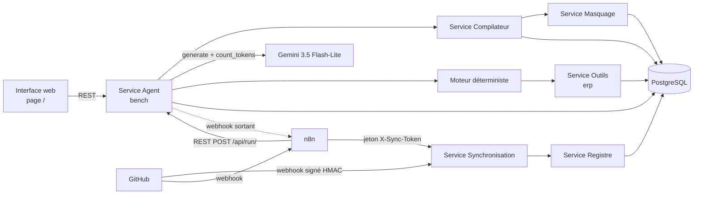
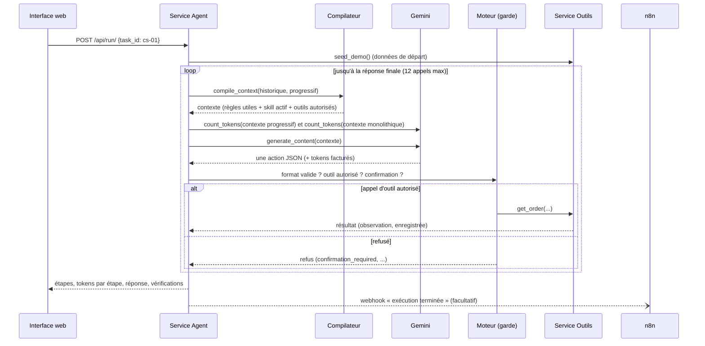
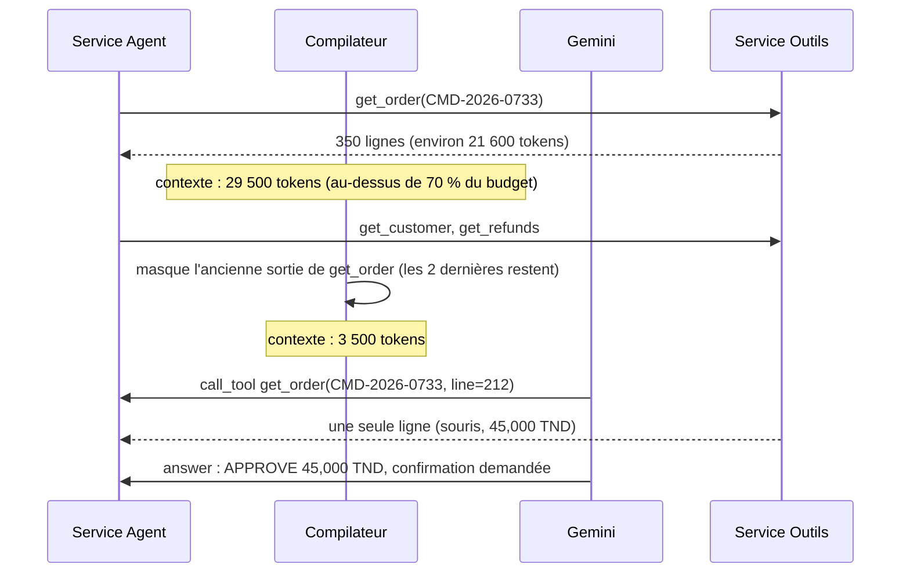
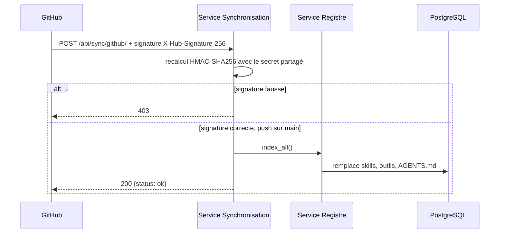
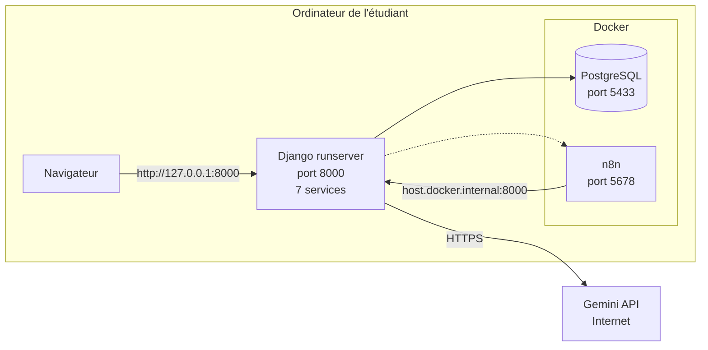

# Architecture orientée services (SOA)

Ce document décrit l'architecture du projet : les services, leurs contrats, la façon dont ils communiquent, et comment on mesure l'économie de tokens. Le [README](../README.md) explique comment installer et utiliser le projet ; [SKILLS.md](SKILLS.md) détaille les skills.

**Images des diagrammes** : tous les diagrammes de ce document (et d'autres : les 3 niveaux, la boucle de l'agent, le budget, le modèle de données) sont rassemblés dans **[DIAGRAMMES.md](DIAGRAMMES.md)**, avec le code à copier dans https://mermaid.live et la méthode pour exporter un PNG ou un SVG.

## 1. Le problème en une phrase

Une IA lit un **contexte** (mesuré en **tokens**) avant de répondre. Si on lui envoie toute la documentation à chaque appel, elle devient plus chère, plus lente et moins précise. Notre **compilateur de contexte** lui envoie **seulement ce qui est utile, au bon moment**, et nous **mesurons** l'économie avec une vraie IA.

## 2. Définitions

| Terme | Définition simple | Dans notre projet |
|---|---|---|
| Service | Un composant indépendant, avec un rôle unique, qui expose une interface (API). | 7 applications Django (§3) |
| API REST | Des adresses web qui reçoivent et renvoient du JSON (GET pour lire, POST pour agir). | Django REST Framework, `@api_view` |
| Contrat de service | Ce qu'un service promet : entrées, sorties, erreurs. | §5 : exemples de requêtes et réponses, codes 400, 403, 404, 503 |
| Couplage faible | Un service n'a pas besoin de connaître le code interne d'un autre. | L'interface web et n8n ne parlent qu'à l'API |
| Webhook | Une « sonnette » : un service appelle l'adresse d'un autre quand un événement arrive. | GitHub → Django (entrant), Django → n8n (sortant) |
| Orchestration | Un chef d'orchestre enchaîne plusieurs services. | Le service Agent enchaîne Compilateur → Gemini → Moteur → Outils |
| Contexte | Tout le texte envoyé à l'IA pour un appel. | Construit par `compiler/core.py` |
| Token | Morceau de mot ; le coût se compte en tokens. | Compté par Gemini (`count_tokens`) pour les mesures, par tiktoken pour le budget interne |
| Mode progressif | Avec notre compilateur : divulgation progressive, budget, masquage. | `compile_context(..., mode="progressive")` |
| Mode monolithique | Sans compilateur : tous les AGENTS.md, skills, annexes et outils à chaque appel, rien n'est masqué. | `compile_context(..., mode="monolithic")` |

## 3. Les 7 services

| Service | App Django | Rôle | Interface | Fichiers principaux |
|---|---|---|---|---|
| **Registre** | `registry` | Lit AGENTS.md, SKILL.md, `tools/*.yaml` ; valide (Pydantic) ; enregistre dans PostgreSQL | `GET /api/skills/`, `index_skills` | `loader.py`, `models.py` |
| **Compilateur** | `compiler` | Construit le contexte (3 niveaux, budget, masquage) ; mode progressif ou monolithique | `POST /api/compile/`, `POST /api/tokens/` | `core.py` |
| **Masquage** | `masking` | Garde les sorties d'outils complètes en base et les remplace par une ligne courte dans le contexte | `GET /api/observations/<id>/` | `services.py` |
| **Moteur déterministe** | `engine` | Garde (droits), exécuteur (appelle les outils), vérificateur (réponse finale) | fonctions appelées par l'Agent | `guard.py`, `executor.py`, `verifier.py` |
| **Outils** | `erp` | Les vraies fonctions métier sur la base de la boutique | `GET /api/tools/`, `POST /api/tools/<nom>/`, `seed_demo` | `tools.py`, `models.py`, `seed.py` |
| **Agent et mesures** | `bench` | Orchestre une requête avec Gemini, mesure les tokens, sert l'interface et le tableau de bord | `GET /api/tasks/`, `POST /api/run/`, `GET /api/runs/`, page `/` | `llm.py`, `loop.py`, `runner.py`, `views.py` |
| **Synchronisation** | `sync` | Webhook GitHub signé (HMAC) et appel n8n : réindexe le registre quand la documentation change | `POST /api/sync/github/`, `POST /api/sync/n8n/` | `views.py`, `services.py` |

**Services externes** : Google **Gemini 3.5 Flash-Lite** (IA), **PostgreSQL 17** (stockage), **n8n** (automatisation), **GitHub** (source de la documentation).

### Pile technique

| Couche | Technologie | Rôle |
|---|---|---|
| Langage, framework | Python 3.14, Django 6.1 | les 7 services |
| API | Django REST Framework 3.18 | vues `@api_view`, page « browsable API » |
| Validation | Pydantic 2 | en-têtes des skills, définitions d'outils, requêtes prédéfinies, actions de l'IA |
| IA | SDK `google-genai` | `generate_content` (réponse JSON imposée) et `count_tokens` |
| Comptage interne | tiktoken | budget du compilateur, hors ligne |
| Base de données | PostgreSQL 17 (Docker) | toutes les tables (§10) |
| Automatisation | n8n (Docker) | workflows du dossier `n8n/` |
| Interface | HTML + CSS + JavaScript, sans framework | `bench/templates/bench/app.html` |
| Tests | pytest, pytest-django | 42 tests, sans réseau |

## 4. Schéma d'architecture



## 5. Les contrats des services (API REST)

Toutes les réponses sont en JSON. Chaque adresse s'ouvre aussi dans le navigateur (page de Django REST Framework).

### 5.1 Service Agent

**`GET /api/tasks/`** : les requêtes prédéfinies que l'utilisateur peut choisir.
```json
{"tasks": [{"id": "cs-01", "department": "customer-service",
            "title": "Rembourser un casque de 349 TND (seuil du sous-domaine)",
            "trap": "none", "expected_skill": "return-request",
            "overridden_rule": "returns : superviseur au-dessus de 200 TND (remplace 300 TND du département)",
            "turns": ["La cliente demande le remboursement de la commande CMD-2026-0457. Peut-on accepter ?"]}]}
```

**`POST /api/run/`** : Gemini exécute une requête. Entrée : `{"task_id": "cs-01", "mode": "progressive"}` (ou `"monolithic"`). Sortie (abrégée) :
```json
{"id": 12, "task_id": "cs-01", "mode": "progressive", "model": "gemini-3.5-flash-lite",
 "passed": true, "llm_calls": 6, "prog_tokens": 18921, "mono_tokens": 33429, "saving_pct": 43.4,
 "input_tokens": 18927, "output_tokens": 364, "duration_s": 30.1,
 "turns": [{"user": "...", "answer": "Decision: HOLD ...", "violations": [],
            "steps": [{"action": "call_tool", "detail": "get_order", "guard": "ok",
                       "arguments": {"order_id": "CMD-2026-0457"}, "compacted": false,
                       "prog_tokens": 3123, "mono_tokens": 4409,
                       "usage": {"input": 3131, "output": 42, "thinking": 0}, "result": "{ ... }"}]}],
 "checks": [{"check": "decision_is", "passed": true, "detail": "décision : HOLD"}]}
```

**`GET /api/runs/`** : les 30 dernières exécutions (résumé) et les totaux du tableau de bord :
```json
{"stats": {"runs": 12, "passed": 11, "prog_tokens": 211067, "mono_tokens": 434370, "saving_pct": 51.4,
           "billed": {"input": 211124, "output": 3314, "thinking": 0},
           "start_prog": 841, "start_mono": 4675},
 "runs": [{"id": 12, "task_id": "cs-01", "prog_tokens": 18921, "mono_tokens": 33429, "saving_pct": 43.4, "...": "..."}]}
```

**`GET /api/runs/<id>/`** : le détail complet d'une exécution (même format que `POST /api/run/`).

### 5.2 Service Outils

**`GET /api/tools/`** : le catalogue (nom, mode, description, paramètres).

**`POST /api/tools/<nom>/`** : appel direct d'un outil **de lecture**, sans IA. Entrée : `{"arguments": {"order_id": "CMD-2026-0457", "line": 1}}`. Sortie : `{"tool": "get_order", "output": "{ ... }"}`.

### 5.3 Services Compilateur, Registre et Masquage

| Adresse | Entrée | Sortie |
|---|---|---|
| `POST /api/compile/` | `{"events": [{"kind": "user", "text": "..."}, {"kind": "activate_skill", "skill": "order-tracking"}], "budget": 6000, "mode": "progressive"}` | le contexte compilé : `text`, `tokens`, `active_skills`, `allowed_tools`, `evictions`, `blocks` |
| `POST /api/tokens/` | `{"text": "Bonjour tout le monde"}` | `{"tokens": 4}` |
| `GET /api/skills/` | | la liste des skills (nom, description, statut, outils, tokens) |
| `GET /api/observations/<id>/` | | la sortie complète d'un outil, même masquée dans le contexte |

### 5.4 Service Synchronisation

| Adresse | Sécurité | Effet |
|---|---|---|
| `POST /api/sync/github/` | en-tête `X-Hub-Signature-256` (HMAC-SHA256 avec `GITHUB_WEBHOOK_SECRET`) | réindexe le registre si c'est un `push` sur `main` |
| `POST /api/sync/n8n/` | en-tête `X-Sync-Token` = `N8N_SYNC_TOKEN` | réindexe le registre |
| `GET /api/sync/events/` | | historique des synchronisations |

### 5.5 Codes d'erreur

| Code | Signification | Exemple |
|---|---|---|
| 400 | entrée invalide | mode inconnu, requête inconnue, `order_id` n'est pas un texte |
| 403 | action interdite | signature GitHub fausse ; appel direct de `create_refund` (écriture réservée à l'agent, après confirmation) |
| 404 | ressource introuvable | outil, exécution ou observation inconnue |
| 503 | Gemini indisponible | clé absente, réseau coupé, Gemini surchargé après 4 essais |

## 6. Le catalogue des outils (service Outils)

Les définitions sont dans `tools/customer-service.yaml` et `tools/common.yaml` ; les fonctions dans `erp/tools.py`. Le registre refuse un outil décrit en YAML qui n'a pas de fonction Python.

| Outil | Mode | Paramètres | Renvoie |
|---|---|---|---|
| `get_order` | lecture | `order_id`, `line` (facultatif : une seule ligne) | client, dates, statut, jours depuis la livraison, total, note du client, lignes |
| `track_shipment` | lecture | `order_id` | transporteur, numéro de suivi, date prévue, jours de retard, étapes du colis |
| `get_customer` | lecture | `customer_id` | nom, ville, niveau de fidélité, **e-mail et téléphone masqués**, nombre de commandes et de remboursements |
| `search_orders` | lecture | `customer_id`, `status`, `limit` | les commandes d'un client |
| `get_product` | lecture | `sku` | nom, catégorie, garantie en mois |
| `get_refunds` | lecture | `order_id` | les remboursements déjà faits et leur total |
| `create_refund` | **écriture** | `order_id`, `amount_tnd`, `reason`, `approved_by` | identifiant du remboursement ; refuse de dépasser le total payé |
| `calculate` | lecture | `expression` | le résultat d'un calcul (+ − × ÷), sans `eval` |

## 7. Diagrammes de séquence

### 7.1 Une requête choisie dans l'interface



### 7.2 Masquage puis relecture ciblée (requête `cs-06`, exécution réelle)



Sans compilateur, les 21 600 tokens de la commande auraient été renvoyés à **chaque** appel (environ 32 000 tokens par appel).

### 7.3 Synchronisation de la documentation



### 7.4 Automatisation avec n8n

| Workflow | Déclencheur | Ce qu'il fait |
|---|---|---|
| `n8n/github_sync_workflow.json` | webhook GitHub reçu par n8n | appelle `POST /api/sync/n8n/` avec le jeton |
| `n8n/scheduled_run_workflow.json` | chaque jour à 08:00 | appelle `POST /api/run/` pour `cs-01` : le tableau de bord se remplit tout seul |
| `n8n/run_report_workflow.json` | webhook envoyé par Django à la fin de chaque exécution (`N8N_RUN_WEBHOOK_URL`) | fabrique un résumé lisible (tokens, économie, résultat) |

## 8. Le compilateur en détail (`compiler/core.py`)

### 8.1 Ce que contient le contexte progressif, dans cet ordre

1. **Règles et skills** : AGENTS.md global, index des skills (une ligne chacun) ; puis, pour chaque skill actif, les AGENTS.md du département et du sous-domaine (le plus proche en dernier) et le corps du skill ; puis les annexes chargées.
2. **Outils autorisés** : les définitions JSON des outils des skills actifs (aucun outil avant l'activation d'un skill).
3. **Conversation** : messages de l'utilisateur, réponses de l'agent, observations (sorties d'outils, éventuellement masquées).

Les règles d'abord et la conversation ensuite : l'IA lit la règle du sous-domaine juste avant la conversation, et elle a priorité.

### 8.2 L'algorithme du budget (6 000 tokens par défaut)

| Étape | Condition | Action | Trace dans `evictions` |
|---|---|---|---|
| 1 | contexte ≥ 70 % du budget | masquer les anciennes observations (les 2 plus récentes restent en clair) | `masked:obs-0351` |
| 2 | contexte > 100 % du budget | retirer les annexes, la plus ancienne d'abord | `unloaded:return-request/refund_policy.md` |
| 3 | toujours > 100 % | désactiver le skill le plus ancien (le plus récent reste) | `deactivated:order-tracking` |
| toujours | un 3e skill est activé | le plus ancien est désactivé (2 skills actifs au maximum) | `deactivated:...` |

Le compilateur est **déterministe** : même historique, même contexte. On peut donc le tester (`compiler/tests.py`).

### 8.3 Le mode monolithique

Tous les AGENTS.md, tous les skills, toutes les annexes et tous les outils, puis la conversation complète. Aucun budget, aucun masquage. C'est la référence « sans compilateur ».

## 9. Comment on mesure l'économie de tokens

À **chaque appel** à Gemini pendant une exécution :
1. le service Agent construit le contexte **progressif** (celui qui est envoyé) ;
2. il construit aussi le contexte **monolithique** à partir du **même historique** ;
3. il demande à **Gemini lui-même** de compter les deux (`count_tokens`, gratuit, sans génération), consignes système comprises ;
4. il enregistre les tokens **réellement facturés** par Gemini (`usage_metadata` : entrée, sortie, réflexion).

Les sommes sont stockées dans la table `Run` (`prog_tokens`, `mono_tokens`, `input_tokens`, `output_tokens`, `thinking_tokens`). Les deux modes reçoivent exactement le même historique : seule la façon de construire le contexte change, donc la comparaison est juste. On peut aussi exécuter réellement une requête en mode monolithique (choix « Sans compilateur » dans l'interface, ou `python manage.py benchmark --real-monolithic`).

### Du stockage au tableau de bord

| Élément du tableau de bord | Donnée | Origine |
|---|---|---|
| Tuiles « Avec / Sans compilateur », « Économie totale » | `stats.prog_tokens`, `stats.mono_tokens`, `stats.saving_pct` | somme des `Run` en mode progressif (`GET /api/runs/`) |
| Tuile « Au démarrage » | `stats.start_prog`, `stats.start_mono` | `compile_context([])` dans les deux modes |
| Graphique par exécution (marine = avec, or = sans) | `runs[].prog_tokens`, `runs[].mono_tokens` | les 12 dernières exécutions progressives |
| Graphique « taille du contexte à chaque appel » | `turns[].steps[].prog_tokens`, `mono_tokens` | une exécution (`GET /api/runs/<id>/`) |
| Tableau des exécutions récentes | `input_tokens`, `output_tokens`, `duration_s`, `passed` | `GET /api/runs/` |

### Résultats mesurés (`python manage.py benchmark`, `gemini-3.5-flash-lite`)

| | Avec compilateur | Sans compilateur | Économie |
|---|---|---|---|
| Au démarrage | 841 | 4 675 | 82 % |
| Total des 9 requêtes | 211 067 | 434 370 | **51 %** |
| Requête `cs-06` (350 lignes) | 74 509 | 170 230 | 56 % |

**9 requêtes sur 9 réussies.** Détail par requête : [BENCHMARK.md](BENCHMARK.md).

## 10. Les tables PostgreSQL

| Service | Tables |
|---|---|
| Registre | `AgentsFile` (règles), `Skill`, `Tool` |
| Masquage | `Observation` (sorties d'outils complètes) |
| Outils (boutique) | `Customer`, `Product`, `Order`, `OrderLine`, `TrackingEvent`, `Refund` |
| Agent | `Run` (une exécution, ses étapes, ses vérifications et ses mesures) |
| Synchronisation | `SyncEvent` |

## 11. Déploiement (poste de développement)



Configuration : fichier `.env` (clé Gemini, modèle, budget, secrets des webhooks), lu par `config/settings.py`.

## 12. Choix d'architecture et qualités

| Qualité | Comment elle est obtenue |
|---|---|
| **Séparation des responsabilités** | un service = une application Django = un rôle ; l'interface et n8n ne passent que par l'API |
| **Économie de tokens** | divulgation progressive, budget, masquage, requêtes étroites (`get_order` avec `line`) |
| **Sécurité** | la garde vérifie skill, outil, arguments et confirmation ; l'API refuse l'écriture directe (403) ; signature HMAC des webhooks ; e-mails, téléphones et IBAN masqués ; les sorties d'outils sont des données, jamais des instructions |
| **Robustesse** | 60 s maximum par appel à Gemini, 3 nouvelles tentatives (503, 429, délai dépassé) ; une erreur est enregistrée au lieu de bloquer l'application ; 12 appels maximum par message |
| **Reproductibilité** | données de démonstration recréées avant chaque exécution (`seed_demo`) ; compilateur déterministe |
| **Testabilité** | 42 tests sans réseau : faux client qui rejoue des actions, faux SDK Gemini |
| **Extensibilité** | un nouveau département = des fichiers AGENTS.md, SKILL.md et `tools/*.yaml` + ses fonctions ; aucun changement du compilateur (squelettes dans `departments/`) |
| **Traçabilité** | chaque exécution, chaque étape, chaque sortie d'outil et chaque synchronisation est enregistrée en base |
