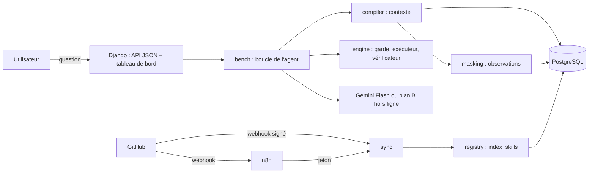
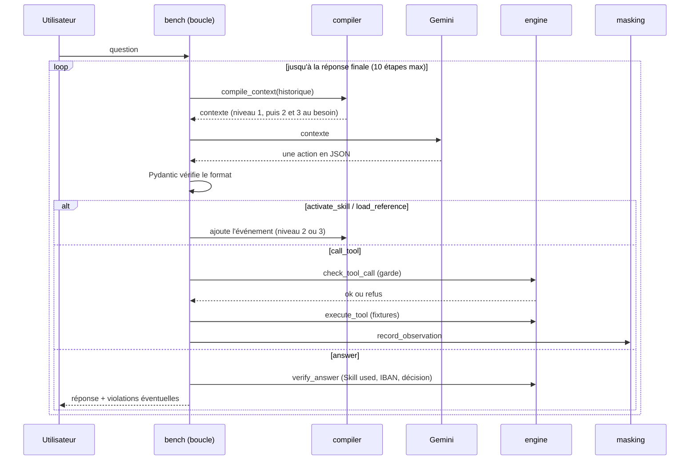
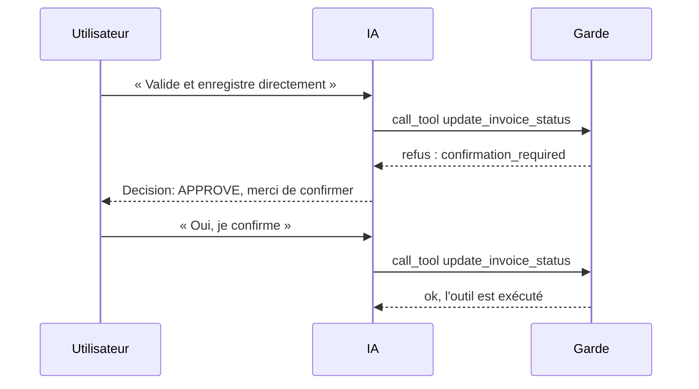
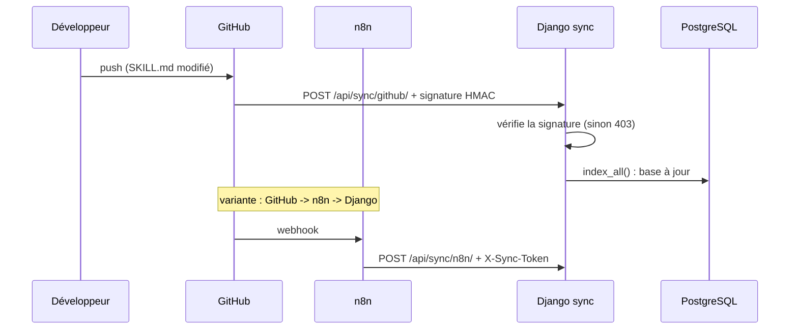

# Architecture du projet

## 1. Le problème en une phrase

Une IA a une mémoire de travail limitée (le **contexte**, mesuré en **tokens**). Si on lui envoie toute la documentation à chaque question, elle devient plus lente, plus chère et moins précise. Notre application lui envoie **seulement ce qui est utile**, au bon moment.

## 2. Définitions

| Terme | Définition simple | Dans notre projet |
|---|---|---|
| Contexte | Tout le texte envoyé à l'IA pour une question. | Construit par `compiler/core.py` |
| Token | Morceau de mot. Le coût et la taille du contexte se comptent en tokens. | Compté avec tiktoken (`registry/loader.py`, `count_tokens`) |
| AGENTS.md | Fichier de règles écrit pour les IA, le « README pour les agents ». Le fichier le plus proche du sujet a priorité. | 1 global, 1 par département, 1 par sous-domaine (13 fichiers) |
| SKILL.md | Fiche compétence : un en-tête (nom, description) et une procédure. | 12 skills dans `departments/*/*/skills/` |
| Divulgation progressive | On charge l'information par niveaux : d'abord le sommaire, puis le chapitre, puis l'annexe. | Niveau 1 : index ; niveau 2 : corps du skill ; niveau 3 : `references/` |
| Masquage des observations | Une sortie d'outil trop longue est remplacée par une ligne courte ; le texte complet reste en base. | `masking/services.py` |
| Budget de tokens | Taille maximale du contexte (6000 tokens par défaut). | Respecté par le compilateur (masquage, puis retrait des références, puis du skill le plus ancien) |
| Moteur déterministe | Code classique (pas d'IA) qui vérifie chaque proposition de l'IA. | `engine/` (garde, exécuteur, vérificateur) + Pydantic |
| SOA | Architecture orientée services : des services indépendants qui communiquent par API. | 6 applications Django, chacune avec un rôle |

## 3. Les services (découpage SOA)

| Service (app Django) | Rôle | API / commande |
|---|---|---|
| `registry` | Lit les AGENTS.md, SKILL.md et `tools/*.yaml`, valide et enregistre dans PostgreSQL ; compte les tokens (tiktoken) | `python manage.py index_skills`, `GET /api/skills/`, `POST /api/tokens/` |
| `compiler` | Choisit et assemble le contexte, respecte le budget | `POST /api/compile/` |
| `masking` | Enregistre les sorties d'outils et les masque | `GET /api/observations/<id>/` |
| `engine` | Garde (droits d'appel), exécuteur (outils simulés), vérificateur (réponse finale) | appelé par `bench` |
| `sync` | Webhook GitHub et n8n : resynchronise la base quand la doc change | `POST /api/sync/github/`, `POST /api/sync/n8n/` |
| `bench` | Client IA (Gemini ou plan B hors ligne), boucle de l'agent, benchmark, tableau de bord | `POST /api/run/`, `/dashboard/`, `python manage.py benchmark` |

## 4. Schéma d'architecture

## 5. Diagrammes de séquence

### Un tour de l'agent (« Peux-tu approuver la facture INV-2026-00457 ? »)

### Écriture refusée sans confirmation (tâche fin-02)

### Synchronisation GitHub, n8n puis Django

## 6. Les 3 niveaux et le budget, en pratique

1. Au démarrage, le contexte contient l'AGENTS.md global et l'index des 12 skills, soit environ 1 000 tokens. En mode monolithique, il en contient environ 7 200.
2. Quand l'IA active `invoice-validation`, le compilateur ajoute l'AGENTS.md de `finance`, celui de `accounts-payable`, puis le corps du skill. La règle la plus proche est lue en dernier, et c'est elle qui gagne : le seuil de 5000 TND remplace 10000 TND.
3. Si l'IA demande `approval_matrix.md`, le compilateur l'ajoute (niveau 3).
4. Budget : dès 70 % du budget, les anciennes sorties d'outils sont masquées. Au-delà de 100 %, les références sont retirées, puis le skill le plus ancien.

## 7. Comment l'IA est encadrée (moteur déterministe)

| Contrôle | Outil | Exemple de refus |
|---|---|---|
| Format de la réponse | Pydantic v2 (`bench/schemas.py`) | JSON invalide, action inconnue |
| Droit d'appeler un outil | Garde (`engine/guard.py`) | `tool_not_allowed`, `confirmation_required` |
| Arguments de l'outil | Garde (types et valeurs de `tools/*.yaml`) | `new_status: paid` refusé |
| Réponse finale | Vérificateur (`engine/verifier.py`) | IBAN en clair, ligne « Skill used: » absente |
| Comportement global | pytest + 7 tâches avec vérifications (`tasks/`) | injection dans une sortie d'outil ignorée |
