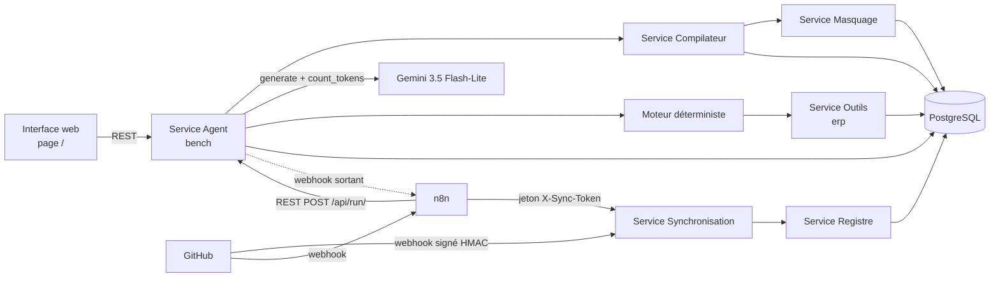
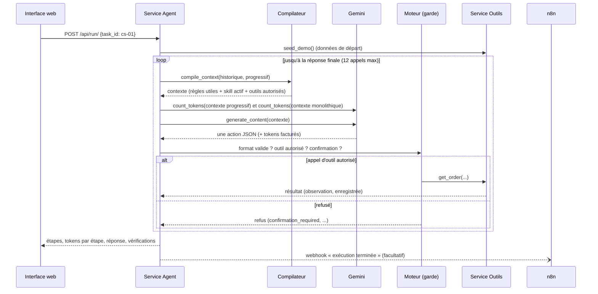
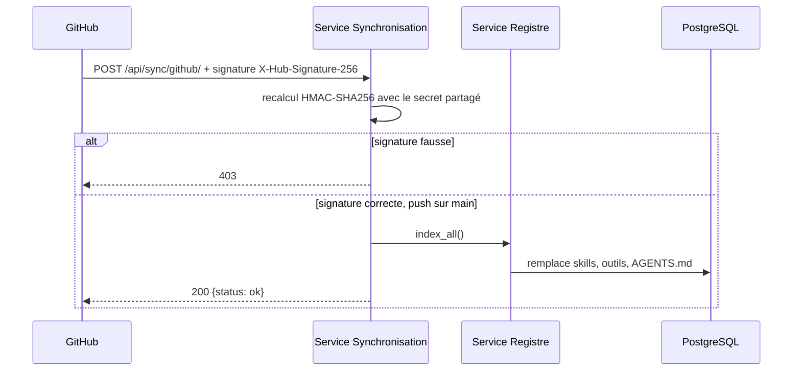

# Architecture orientée services (SOA)

## 1. Le problème en une phrase

Une IA lit un **contexte** (mesuré en **tokens**) avant de répondre. Si on lui envoie toute la documentation à chaque appel, elle devient plus chère, plus lente et moins précise. Notre **compilateur de contexte** lui envoie **seulement ce qui est utile, au bon moment**, et nous **mesurons** l'économie.

## 2. Définitions

| Terme | Définition simple | Dans notre projet |
|---|---|---|
| Service | Un composant indépendant, avec un rôle unique, qui expose une interface (API). | 7 applications Django (tableau ci-dessous) |
| API REST | Des adresses web qui reçoivent et renvoient du JSON (GET pour lire, POST pour agir). | Django REST Framework, `@api_view` |
| Contrat de service | Ce qu'un service promet : entrées, sorties, erreurs. | Chaque vue DRF documente ses entrées/sorties ; codes 400, 403, 404, 503 |
| Couplage faible | Un service n'a pas besoin de connaître le code interne d'un autre. | L'interface web ne parle qu'à l'API ; n8n ne parle qu'à l'API |
| Webhook | Une « sonnette » : un service appelle l'adresse d'un autre quand un événement arrive. | GitHub → Django (entrant), Django → n8n (sortant) |
| Orchestration | Un chef d'orchestre enchaîne plusieurs services. | Le service Agent enchaîne Compilateur → Gemini → Moteur → Outils |
| Contexte | Tout le texte envoyé à l'IA pour un appel. | Construit par `compiler/core.py` |
| Token | Morceau de mot ; le coût se compte en tokens. | Compté par Gemini (`count_tokens`) pour les mesures, par tiktoken pour le budget interne |
| Mode progressif | Notre compilateur : divulgation progressive, budget, masquage. | `compile_context(..., mode="progressive")` |
| Mode monolithique | Sans compilateur : tout est chargé à chaque appel. | `compile_context(..., mode="monolithic")` |

## 3. Les 7 services

| Service | App Django | Rôle | Interface |
|---|---|---|---|
| **Registre** | `registry` | Lit AGENTS.md, SKILL.md, `tools/*.yaml` ; valide (Pydantic) ; enregistre dans PostgreSQL | `GET /api/skills/`, `python manage.py index_skills` |
| **Compilateur** | `compiler` | Construit le contexte (3 niveaux, budget, masquage) ; mode progressif ou monolithique | `POST /api/compile/`, `POST /api/tokens/` |
| **Masquage** | `masking` | Garde les sorties d'outils complètes en base et les remplace par une ligne courte dans le contexte | `GET /api/observations/<id>/` |
| **Moteur déterministe** | `engine` | Garde (droits), exécuteur (appelle les outils), vérificateur (réponse finale) | fonctions Python appelées par l'Agent |
| **Outils** | `erp` | Les vraies fonctions métier sur la base de la boutique (commandes, clients, remboursements) | `GET /api/tools/`, `POST /api/tools/<nom>/` |
| **Agent et mesures** | `bench` | Orchestration d'une requête avec Gemini, mesure des tokens, tableau de bord | `GET /api/tasks/`, `POST /api/run/`, `GET /api/runs/`, page `/` |
| **Synchronisation** | `sync` | Webhook GitHub signé (HMAC) et appel n8n : réindexe le registre quand la doc change | `POST /api/sync/github/`, `POST /api/sync/n8n/` |

Services externes : **Google Gemini 3.5 Flash-Lite** (IA), **PostgreSQL** (stockage), **n8n** (automatisation), **GitHub** (source de la documentation).

## 4. Schéma d'architecture

## 5. Diagrammes de séquence

### Une requête choisie dans l'interface

### Synchronisation de la documentation

## 6. Comment on mesure l'économie de tokens

À **chaque appel** à Gemini pendant une exécution :
1. le service Agent construit le contexte **progressif** (celui qui est envoyé) ;
2. il construit aussi le contexte **monolithique** à partir du **même historique** (tous les AGENTS.md, tous les skills, toutes les annexes, tous les outils, aucune sortie masquée) ;
3. il demande à **Gemini lui-même** de compter les deux (`count_tokens`, gratuit, sans génération) ;
4. il enregistre aussi les tokens **réellement facturés** par Gemini (`usage_metadata`).

Les sommes sont stockées dans la table `Run` (`prog_tokens`, `mono_tokens`, `input_tokens`, `output_tokens`) et affichées par le tableau de bord. Les deux modes reçoivent exactement le même historique : seule la façon de construire le contexte change, donc la comparaison est juste.

Il est aussi possible d'exécuter réellement une requête en mode monolithique (bouton « Sans compilateur » de l'interface, ou `python manage.py benchmark --real-monolithic`).

## 7. Les tables PostgreSQL

| Service | Tables |
|---|---|
| Registre | `AgentsFile`, `Skill`, `Tool` |
| Masquage | `Observation` |
| Outils (boutique) | `Customer`, `Product`, `Order`, `OrderLine`, `TrackingEvent`, `Refund` |
| Agent | `Run` (une exécution, ses étapes et ses mesures) |
| Synchronisation | `SyncEvent` |
