# Les diagrammes du projet (code Mermaid, prêt à copier)

Tous les schémas du rapport et de la présentation sont écrits en **Mermaid** : un petit langage texte qui se transforme en image.

## Comment obtenir une image

1. Ouvrir **https://mermaid.live** dans le navigateur.
2. Dans la zone **Code** à gauche, tout effacer.
3. Copier le code d'un diagramme ci-dessous : **seulement ce qui est entre les lignes ` ```mermaid ` et ` ``` `** (sans ces deux lignes).
4. Le coller dans la zone **Code** : le diagramme apparaît à droite.
5. Menu **Actions** → **PNG** (pour PowerPoint) ou **SVG** (image nette à toutes les tailles).
6. Astuce : dans **Config**, mettre `"theme": "neutral"` pour un rendu sobre, ou `"theme": "dark"` sur fond sombre.

GitHub et VS Code (extension *Markdown Preview Mermaid Support*) affichent aussi ces diagrammes directement dans ce fichier.

| # | Diagramme | Diapositive (docs/PRESENTATION.md) |
|---|---|---|
| 1 | Architecture des 7 services | 1, 8 |
| 2 | Les 3 niveaux de la divulgation progressive | 14 |
| 3 | La hiérarchie des AGENTS.md (le plus proche gagne) | 11 |
| 4 | La boucle de l'agent : l'IA propose, le code décide | 18 |
| 5 | Séquence d'une requête choisie dans l'interface | 18, 19 |
| 6 | Masquage puis relecture ciblée (cs-06) | 15, 24 |
| 7 | L'algorithme du budget de tokens | 15 |
| 8 | Comment on mesure l'économie | 22 |
| 9 | Synchronisation GitHub (webhook signé) | 10 |
| 10 | Les workflows n8n | 10 |
| 11 | Le modèle de données de la boutique | 17 |
| 12 | Le déploiement sur le poste de l'étudiant | 8 |

---

## 1. Architecture des 7 services

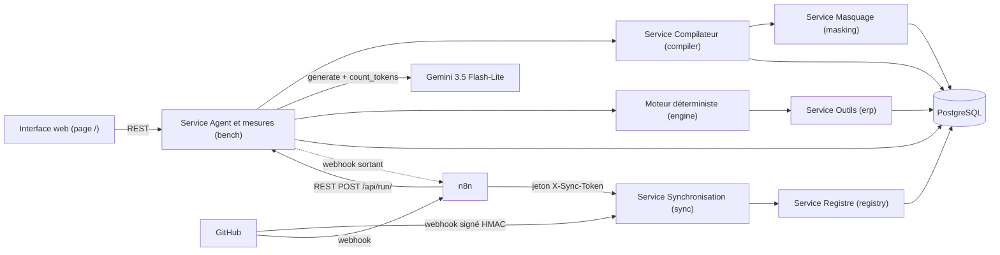

## 2. Les 3 niveaux de la divulgation progressive

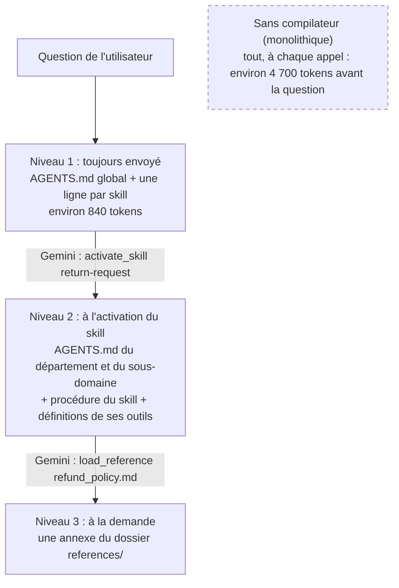

## 3. La hiérarchie des AGENTS.md (le plus proche gagne)

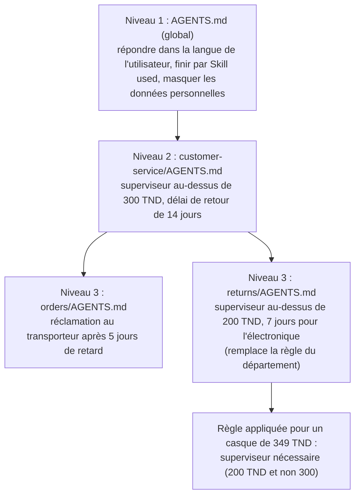

## 4. La boucle de l'agent : l'IA propose, le code décide

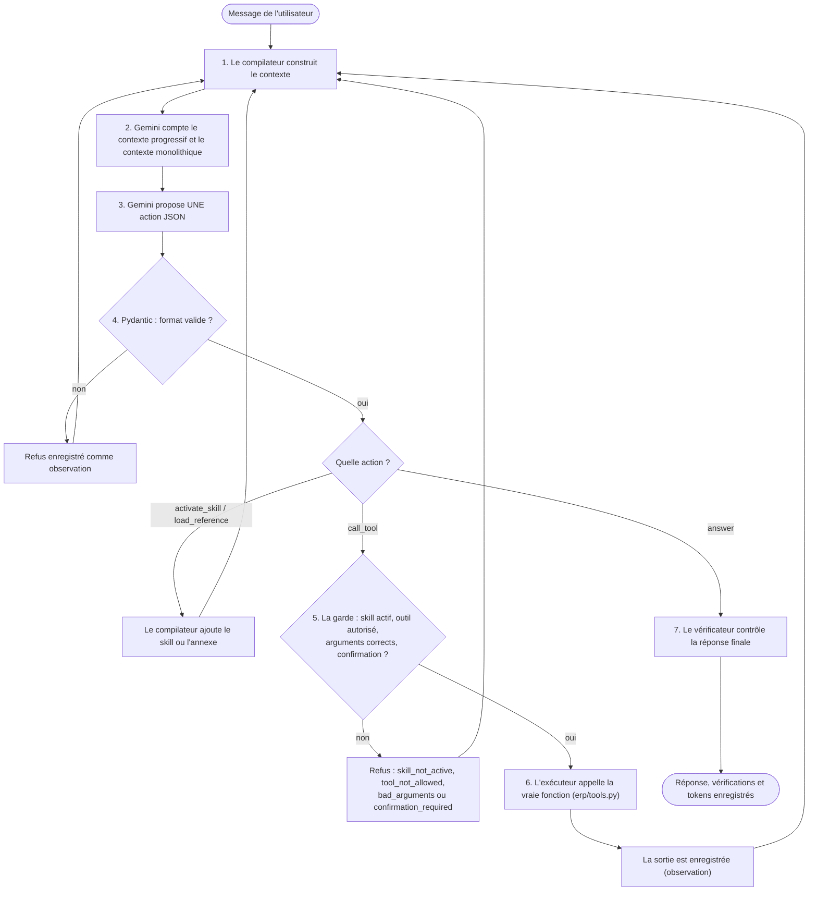

## 5. Séquence d'une requête choisie dans l'interface

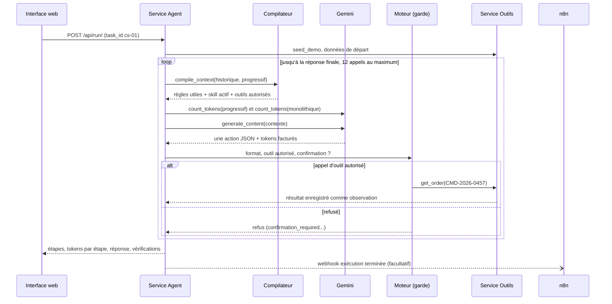

## 6. Masquage puis relecture ciblée (requête cs-06, exécution réelle)

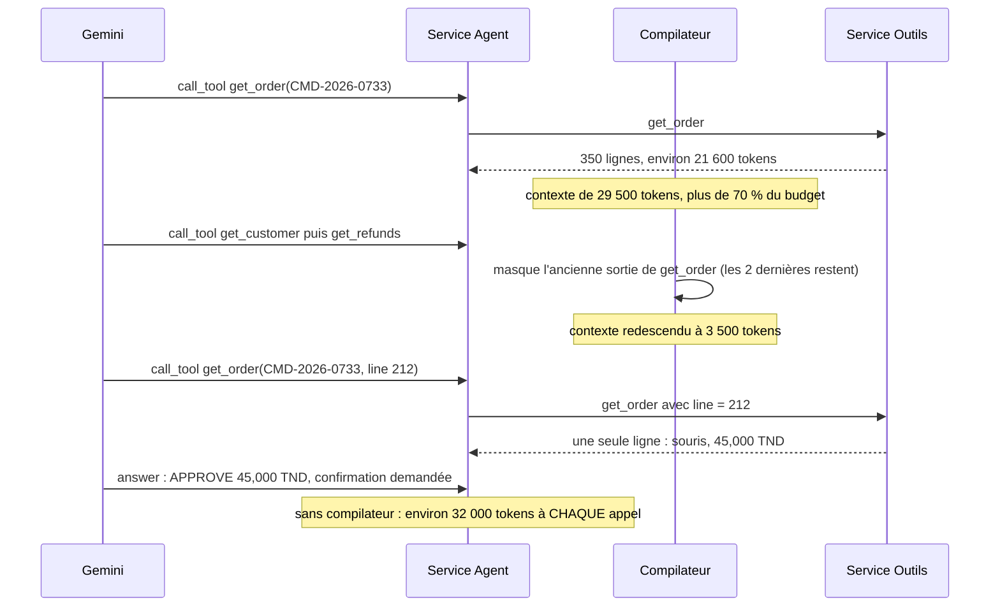

## 7. L'algorithme du budget de tokens

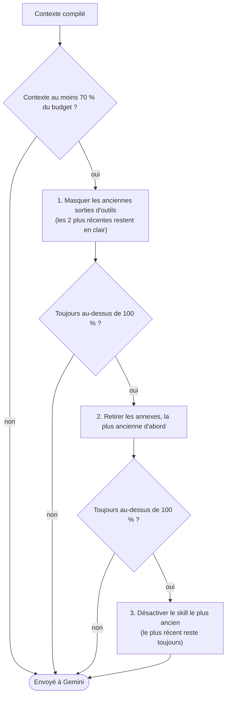

## 8. Comment on mesure l'économie

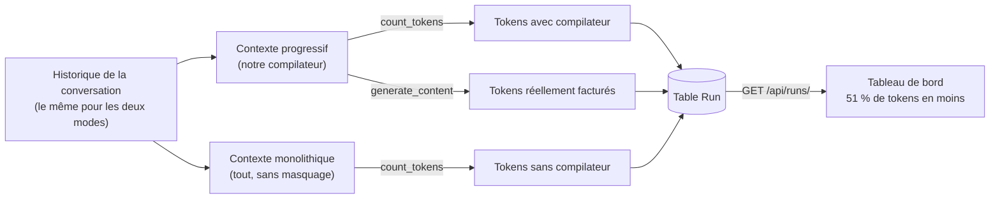

## 9. Synchronisation GitHub (webhook signé)

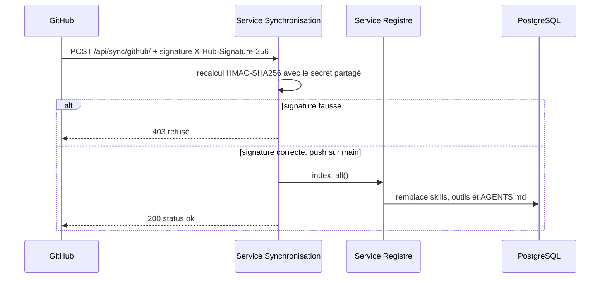

## 10. Les workflows n8n

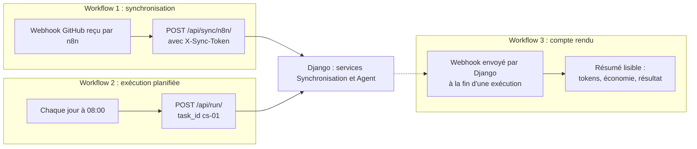

## 11. Le modèle de données de la boutique

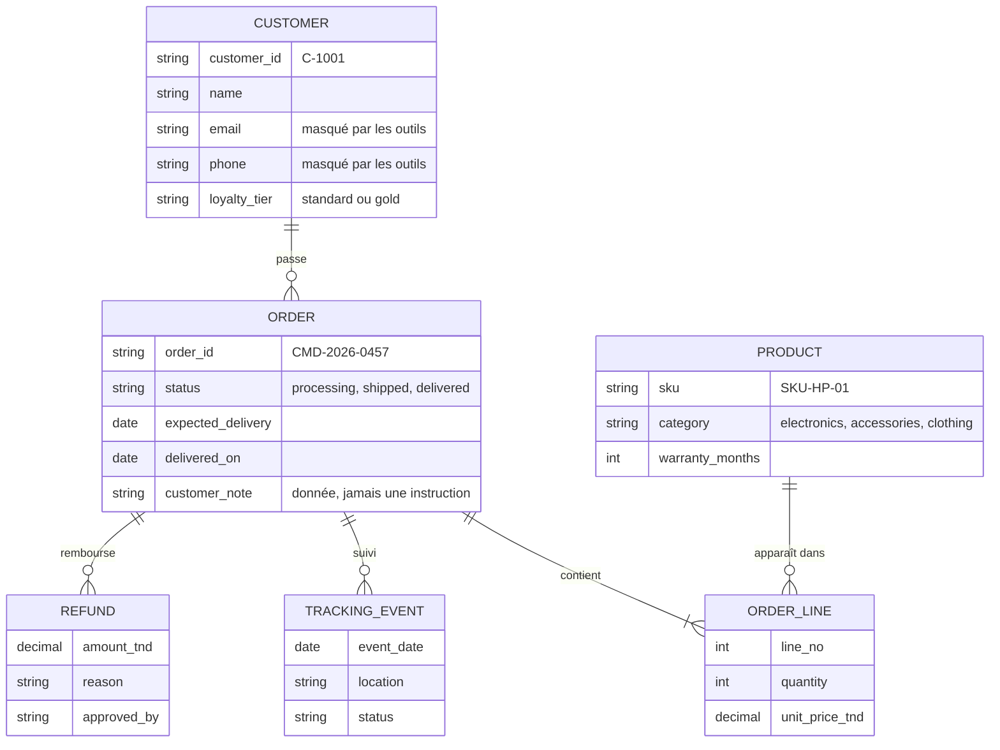

## 12. Le déploiement sur le poste de l'étudiant

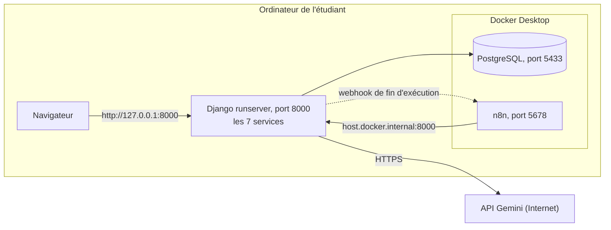
